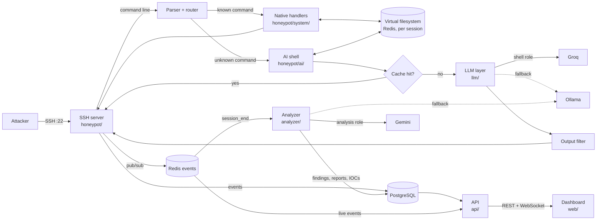
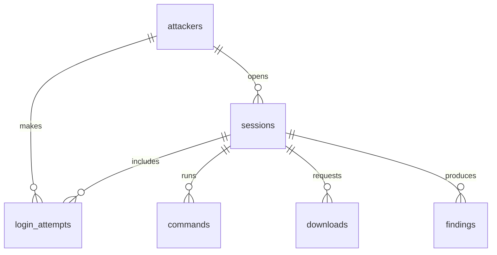

# Mirage architecture

Mirage is an LLM-powered adaptive SSH honeypot. It presents a believable, vulnerable
Linux server to the internet, keeps attackers engaged with simulated shell output,
records everything, and turns the recordings into threat intelligence.

> **Safety model in one line:** Mirage never executes attacker input. Every byte an
> attacker sees is generated by our own code or by an LLM.

## Components

| Component | Path | Responsibility |
|---|---|---|
| SSH server | `honeypot/` | asyncssh listener, auth logging, PTY/exec sessions, asciinema recording, per-IP limits |
| Fake system engine | `honeypot/system/` | YAML personas, per-session virtual filesystem, command parser, ~40 native command handlers |
| AI shell | `honeypot/ai/` | Prompt building, state-change parsing, response cache, injection defence, character-break filter, latency padding |
| LLM layer | `llm/` | `LLMProvider` interface, Groq / Gemini / Ollama providers, env-driven factory, fallback chain, rate and budget tracking |
| Analyzer | `analyzer/` | Rule-based + LLM ATT&CK mapping, intent / skill / bot-vs-human, campaign clustering, reports, IOC export |
| API | `api/` | FastAPI REST, `/ws/live` WebSocket, JWT admin login |
| Dashboard | `web/` | React + Vite + TypeScript + Tailwind SOC dashboard: live map, analytics, ATT&CK heatmap, session replay |
| Infra | `infra/` | Dockerfiles, production compose override, firewall, backups, deploy docs |
| PostgreSQL | compose | Durable history: attackers, sessions, commands, findings |
| Redis | compose | Per-session virtual filesystem state (TTL), AI response cache, live event pub/sub, analysis job queue |

### LLM roles

| Role | Env vars | Default | Used for |
|---|---|---|---|
| Shell | `SHELL_LLM_PROVIDER` / `SHELL_LLM_MODEL` | Groq | Live replies to commands the native engine does not handle (hard ~3s timeout) |
| Analysis | `ANALYSIS_LLM_PROVIDER` / `ANALYSIS_LLM_MODEL` | Gemini | Post-session transcript review, structured JSON output |
| Fallback | `FALLBACK_LLM_PROVIDER` / `FALLBACK_LLM_MODEL` | Ollama `qwen2.5:7b` | Used on 429, timeout, provider error or exhausted budget |

Model names are read from env only, never hardcoded. An `AnthropicProvider` can be added
later as one more file implementing `LLMProvider`.

## Data flow

## Session lifecycle

1. **Connect.** The server shows a realistic OpenSSH banner. Per-IP connection limits
   apply. A `new_connection` event is published and the attacker row is created or
   updated (GeoIP / ASN enrichment, cached).
2. **Authenticate.** Every attempt is logged (ip, port, username, password, client
   version, timestamp). Logins succeed for a configurable weak-credential list, plus a
   small random chance after N failures.
3. **Session start.** A persona is chosen, a virtual filesystem is created from it and
   stored in Redis, and asciinema v2 recording begins. Both interactive PTY sessions and
   `ssh host "command"` exec requests are supported.
4. **Command loop.** Each line is parsed (pipes, `&&`, `;`, redirections, variable
   expansion) and routed:
   - **native**: a deterministic handler answers from the virtual filesystem;
   - **cache**: a previous AI answer for the same (persona, command, state hash) is reused;
   - **ai**: the shell LLM returns raw terminal output plus a strictly parsed block of
     state changes, which are applied to the virtual filesystem so later commands stay
     consistent. Output passes the character-break filter and gets human-like latency.

   Each command is stored with its handler type, latency and token usage, and published
   as a `command` event.
5. **Downloads.** `wget` / `curl` are faked: the URL is recorded and realistic output is
   simulated. Optionally (off by default) the file is fetched into an isolated quarantine
   directory where only its SHA256 and size are kept.
6. **Session end.** On exit, disconnect or timeout the recording is closed, the session
   row is finalised and `session_end` is published.
7. **Analysis.** The analyzer worker picks up `session_end`, applies rule-based ATT&CK
   mapping, and for non-trivial sessions asks the analysis LLM for techniques, intent,
   skill level, bot-vs-human and a narrative. It writes findings, a per-session report
   and IOCs, and updates attacker profiles and campaign clusters.
8. **Presentation.** The API serves history over REST and live events over WebSocket to
   the dashboard.

## The "never execute" safety model

These rules are invariants. Any change that weakens one is a bug.

1. **No execution.** Attacker input is never passed to `subprocess`, `os.system`,
   `eval`, `exec`, a real shell or a container. It is only parsed as text.
2. **Simulated output only.** Replies come from native handlers working on the virtual
   filesystem, or from an LLM. The real host filesystem is never read to answer a command.
3. **Inert payloads.** Downloads are fake by default. With quarantine enabled, files are
   stored as blobs with no execute bit, outside any path that is ever run, and only
   their hash and size are used.
4. **Attacker input is data, not instructions.** In prompts it is wrapped and clearly
   delimited. The system prompt keeps the model in character as a terminal, and a
   post-filter replaces any output that breaks character (mentions of AI, model names,
   "honeypot", markdown fences) with a plausible shell error.
5. **Bounded cost.** Hard timeouts, per-session and per-day request and token budgets
   per provider, and a fallback chain that ends in generic `command not found` /
   `Permission denied`, so an attacker cannot run up a bill or stall the shell.
6. **Contained network.** In production the honeypot container has no outbound internet
   except the LLM APIs (and the optional quarantine downloader). Postgres and Redis are
   not exposed publicly. The real admin SSH runs on a separate key-only port.
7. **No secrets in the bait.** Bait files (fake AWS keys, `id_rsa`, `wp-config.php`)
   are fabricated. Real keys live only in `.env`, which is gitignored.

## Database schema (draft)

Final models and Alembic migrations land in Part 4. This is the working draft.

| Table | Columns |
|---|---|
| `attackers` | `id` PK, `ip` (unique, inet), `country`, `city`, `latitude`, `longitude`, `asn`, `as_org`, `abuse_score` (nullable), `first_seen`, `last_seen`, `session_count` |
| `sessions` | `id` PK (uuid), `attacker_id` FK, `persona`, `username`, `started_at`, `ended_at`, `client_version`, `src_port`, `recording_path`, `is_interactive`, `end_reason`, `intent`, `skill_level`, `is_bot`, `narrative`, `cluster_id` (nullable) |
| `login_attempts` | `id` PK, `attacker_id` FK, `session_id` FK (nullable), `username`, `password`, `auth_method`, `success`, `client_version`, `src_port`, `created_at` |
| `commands` | `id` PK, `session_id` FK, `seq`, `text`, `output`, `exit_code`, `handler` (`native` \| `ai` \| `cache`), `provider` (nullable), `latency_ms`, `prompt_tokens`, `completion_tokens`, `created_at` |
| `downloads` | `id` PK, `session_id` FK, `url`, `sha256` (nullable), `size` (nullable), `quarantined`, `created_at` |
| `findings` | `id` PK, `session_id` FK, `technique_id` (e.g. `T1059.004`), `technique_name`, `tactic`, `confidence`, `evidence`, `source` (`rule` \| `llm`), `created_at` |

Indexes to expect: `attackers.ip`, `sessions.started_at`, `sessions.attacker_id`,
`login_attempts.created_at`, `commands(session_id, seq)`, `findings.technique_id`,
`downloads.sha256`.

### Redis keys (draft)

| Key | Purpose |
|---|---|
| `mirage:session:{id}:vfs` | Serialized virtual filesystem, TTL |
| `mirage:cache:{persona}:{hash}` | AI response cache |
| `mirage:budget:{provider}:{yyyymmdd}` | Daily request / token counters |
| `mirage:events` (pub/sub) | `new_connection`, `login_attempt`, `command`, `download`, `session_end` |
| `mirage:analysis:queue` | Pending analysis jobs |
